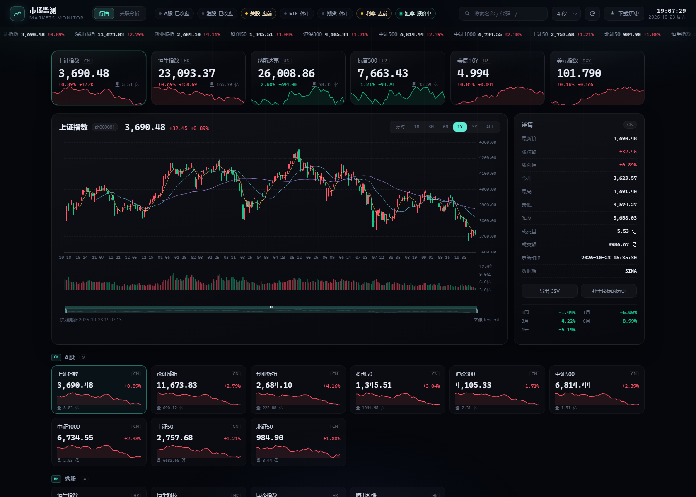
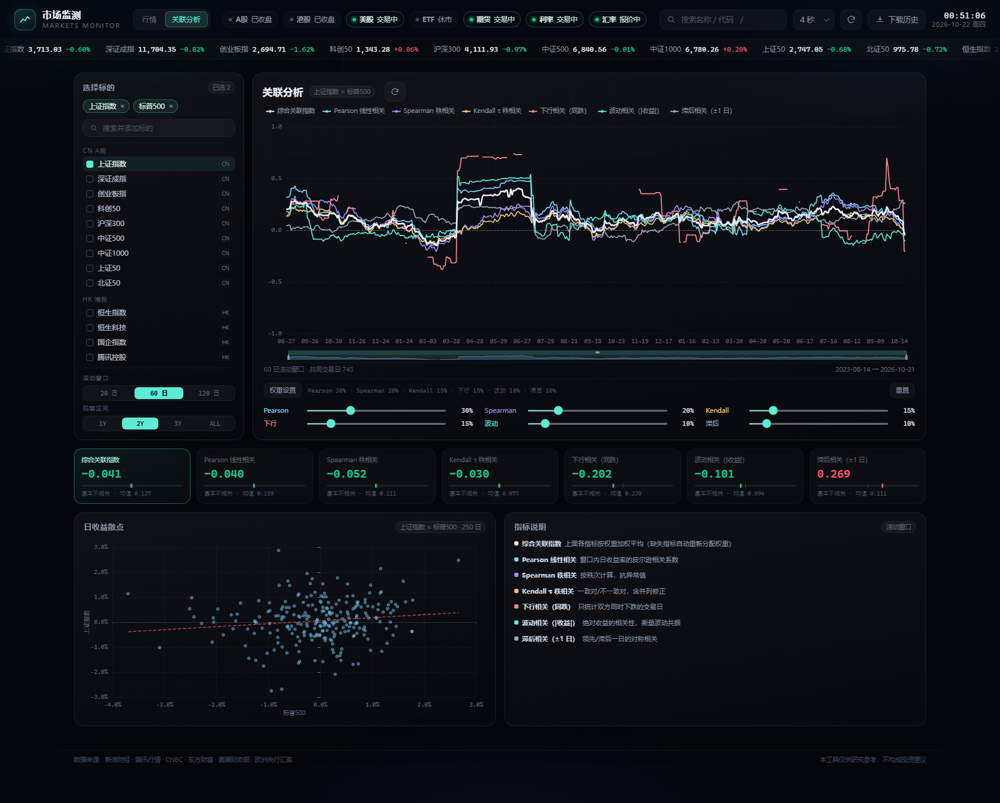
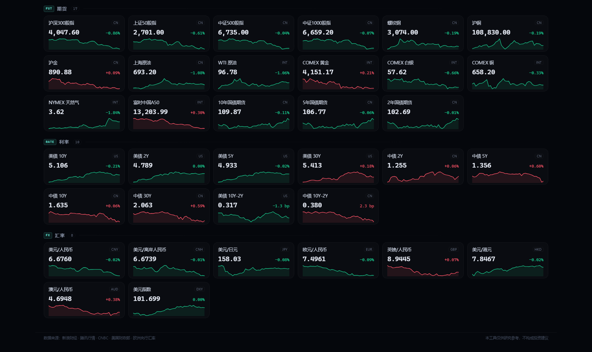

# 市场监测 · Markets Monitor

一个用 Python 写的本地行情监测面板：实时抓取 **A 股 / 港股 / 美股 / 期货 / ETF / 利率 / 汇率** 的核心指标，
同时把历史数据落到本地数据库，并用一个深色数据终端风格的网页界面呈现。





## 特性

- **74 个核心标的，7 大类**：A 股 9 大指数、港股 4 项、美股 11 项、ETF 15 只（含 3 只国债 ETF）、期货 17 个（含国债期货）、利率 10 项（美债 / 中债各 4 个期限 + 2 个利差）、汇率 8 项。
- **实时多源互备**：新浪财经、腾讯行情、CNBC、东方财富四路并行抓取，按标的配置优先源；某一路失败时自动切到备用源，并保留上一笔价格、标记为过期，不会让界面塌掉。
- **历史数据下载**：**74 个标的全部本地化**，日 / 周 / 月三档齐全（源只给日线时按自然周、自然月本地聚合），共 27 万+ 根 K 线，统一写入 SQLite 并导出 CSV 到 `data/exports/`。
- **自建 Web 面板**：只用 Python 标准库起服务，前端 ECharts 图表 + 原生 JS，无构建步骤、无前端依赖。
- **看的舒服的细节**：跑马灯、迷你走势、涨跌闪烁、区间收益、CSV 导出、搜索过滤、`#标的代码` 直达链接、红涨绿跌。
- **首次启动自动建档**：本地库为空时，后台自动把全部标的历史拉一遍，不用先手动跑命令。
- **关联性分析**：任选 2~8 个标的，用 6 种相关性指标观察关联度随时间的变化，每个指标一条曲线；两标的额外给收益散点与回归线，多标的自动两两配对取平均并列出明细。

## 快速开始

**Windows 安装包（推荐）**：运行 `dist\MarketMonitor-Setup.exe`，选一个目录安装，完成后从桌面 / 开始菜单启动。无需安装 Python。

**免安装**：解压 `dist\MarketMonitor-portable.zip`，双击里面的 `MarketMonitor.exe`。

```bash
# 源码方式
pip install -r requirements.txt
python run.py            # 网页版，自动打开 http://127.0.0.1:8765/
python desktop.py        # 桌面版，弹出独立应用窗口
```

## 安装包（Windows）

`dist\MarketMonitor-Setup.exe`（24.9 MB）是一个原生 .NET 安装程序，不依赖 Python，也不会把自己解压到临时目录。

| 步骤 | 说明 |
| --- | --- |
| 1 | 双击 `MarketMonitor-Setup.exe` |
| 2 | 选择安装目录，默认 `%LOCALAPPDATA%\Programs\MarketMonitor`（普通用户权限即可，不需要管理员） |
| 3 | 勾选桌面 / 开始菜单快捷方式、安装后立即启动 |
| 4 | 点「安装」，完成后即可从快捷方式启动 |

- 安装内容就是便携版目录：`MarketMonitor.exe` + `_internal\`，数据随后写在 `<安装目录>\data\`。
- **不要选盘符根目录**（如 `F:\MarketMonitor`）或 `C:\Program Files` 这类受保护目录：部分卷的根目录由系统托管，普通用户没有创建权限。安装器会显示系统返回的具体原因，并提供「改用推荐目录」（`%LOCALAPPDATA%\Programs\MarketMonitor`）的一键入口。
- 想要“所有用户可用”的安装位置，需要提权：安装器会弹窗确认，可直接以管理员身份重启并自动继续安装。
- 若真的装进了只读目录，程序运行时会把数据写到 `%LOCALAPPDATA%\MarketMonitor\data`（程序目录只读时的自动回退），卸载时这份数据需要手动删除。
- 卸载：安装目录里的 `uninstall.bat`，或「设置 → 应用」里的「市场监测」（会一并删除 `data\`）。
- 静默安装（批量部署）：
  ```bat
  MarketMonitor-Setup.exe --silent --dir "D:\Apps\MarketMonitor" --no-launch
  ```
  可选参数：`--no-desktop`、`--no-startmenu`、`--log setup.log`。
- 受限环境（组策略/沙箱）下如果写不了桌面快捷方式或 HKCU 注册表，安装**不会中断**，只跳过对应步骤并在日志里说明。

## 便携版（免安装）

`dist\MarketMonitor-portable.zip` 解压后是一个完整目录，双击 `MarketMonitor.exe` 运行：

```
MarketMonitor\
├─ MarketMonitor.exe     ← 双击这个
├─ _internal\            ← 运行时依赖，不要动
└─ data\                 ← 首次运行自动生成
   ├─ market.db          # K 线历史库
   ├─ exports\           # CSV 导出
   ├─ app.log            # 运行日志
   └─ ui-profile\        # 应用窗口的浏览器配置
```

- **完全绿色**：数据、日志、导出、窗口配置全部在 exe 同级的 `data\` 里；`%LOCALAPPDATA%`、`%TEMP%` 都不再写入。
- **不做临时解压**：采用 PyInstaller 的 onedir 模式，exe 直接加载 `_internal\` 里的运行时，不会出现 “Could not create temporary directory”。
- 窗口用 **Edge / Chrome 的应用模式**打开：无地址栏、无标签页、独立任务栏图标；机器上没有 Chromium 浏览器时退回默认浏览器。
- 若整个目录被放在只读位置（如 Program Files），数据会自动改写到 `%LOCALAPPDATA%\MarketMonitor\data`。
- 首次运行本地库为空，会在后台自动下载全部标的历史（约 1 分钟），期间界面可正常使用。
- 命令行参数：`--selftest`（自检后退出）、`--no-window`（只起服务）、`--port 9000`。

**自行打包**：

```powershell
python -m venv .venv
.\.venv\Scripts\pip install requests numpy pillow pyinstaller
powershell -ExecutionPolicy Bypass -File tools\build.ps1
```

产物：`dist\MarketMonitor\`（目录）、`dist\MarketMonitor-portable.zip`、`dist\MarketMonitor-Setup.exe`。
安装器由 `installer\Installer.cs` 用系统自带的 `csc.exe` 编译（.NET Framework 4.x），payload 作为程序集资源内嵌。

## 命令

| 命令 | 说明 |
| --- | --- |
| `python run.py` | 启动面板（等同 `serve`） |
| `python desktop.py` | 启动桌面版（独立窗口） |
| `python desktop.py --selftest` | 桌面版自检 |
| `python run.py serve --port 9000 --no-browser` | 指定端口、不自动开浏览器 |
| `python run.py download` | 刷新全部标的历史（日/周/月）到 `data/`，补全派生指标并导出 CSV |
| `python run.py check` | 自检：各数据源实时覆盖率 |
| `python run.py check --history` | 自检：额外验证每个标的的历史接口 |
| `python run.py list` | 列出全部监测标的 |

## 数据源

| 数据 | 实时 | 历史 |
| --- | --- | --- |
| A 股指数 / ETF | 新浪 `hq.sinajs.cn`（主）、腾讯（备） | 腾讯 K 线（约 3 年）+ 新浪 K 线兜底；北证 50 同源 |
| 港股 | 新浪、腾讯 | 腾讯 K 线 |
| 美股指数 / ETF | 腾讯（主）、新浪 `gb_`（备） | 腾讯 K 线 / 新浪美股日线（个股可达 10 年以上） |
| 美股 VIX | CNBC | CNBC 图表历史 |
| 国内期货 | 新浪 `nf_` | 新浪期货日线（部分品种可回溯至 2005 年） |
| 国债期货 T / TF / TS | 新浪 `nf_T0` 等 | 新浪期货日线（2017 年起） |
| 国际期货 | 新浪 `hf_` | 新浪全球期货日线 |
| 美债收益率 | CNBC | 美国财政部官方日度收益率曲线（约 10 年，CNBC 兜底） |
| 中债收益率 2/5/10/30Y | CNBC（2Y、10Y 盘中）+ 东财（收盘估值） | 东方财富中美国债收益率数据集（2002 年起日线） |
| 国债 ETF（511260 / 511010 / 511090） | 新浪、腾讯 | 腾讯 K 线（约 3 年） |
| 汇率 | 新浪 `fx_` | 欧洲央行（frankfurter.app）；离岸人民币用 CNBC `CNH=` |
| 美元指数 | 新浪 `DINIW` | CNBC 图表历史 |

> 周期：日 / 周 / 月。腾讯源直接提供周月线；其余源只有日线，入库时按自然周、自然月本地聚合出周/月线。
> 所有时间均为北京时间。免费公开接口偶有限流，面板会记录失败次数并在界面上提示。

## 界面说明

- **顶部**：各市场交易状态灯（盘中 / 集合竞价 / 午休 / 盘后 / 休市，含美股夏令时换算）、搜索、刷新频率、下载按钮。
- **大卡**：上证、恒指、纳指、标普、美债 10Y、美元指数，附 40 日迷你走势。
- **主图**：点击任意标的切换；日线蜡烛 + MA5/20/60 + 成交量；`3Y` / `ALL` 自动切周线 / 月线；债券与汇率用面积折线。
- **右栏**：开高低收、成交量额、更新时间、数据源、区间收益（1 周 ~ 1 年，债券以 bp 计）。
- **分组**：按 7 大类平铺，点击卡片即选中，`/` 搜索、`R` 手动刷新。



## 关联分析

顶部切到「关联分析」，左侧勾选 2~8 个标的（可搜索），右侧即时计算。

| 指标 | 含义 |
| --- | --- |
| **综合关联指数** | 下面 6 个指标按权重加权平均得到的统一指标；某点缺失的指标会自动重新分配权重 |
| Pearson 线性相关 | 窗口内日收益率的皮尔逊相关系数，最常用但受异常值影响 |
| Spearman 秩相关 | 用秩次替代数值，抗极端行情 |
| Kendall τ 秩相关 | 一致对 / 不一致对之差，含并列修正，小样本更稳健 |
| 下行相关（同跌） | 只统计窗口内双方同时下跌的交易日，衡量“一起跌”的程度 |
| 波动相关（\|收益\|） | 绝对收益的相关性，衡量波动是否共振 |
| 滞后相关（±1 日） | `corr(A_t, B_{t-1})` 与 `corr(B_t, A_{t-1})` 的平均，判断领先 / 滞后 |

**综合指标权重**：默认 Pearson 30% / Spearman 20% / Kendall 15% / 下行 15% / 波动 10% / 滞后 10%。
点开图下方「权重设置」拖动滑杆即可调整，曲线实时重算；权重存在浏览器 `localStorage`，下次打开沿用。

- 滚动窗口可选 **20 / 60 / 120 日**，观察区间 **1Y / 2Y / 3Y / ALL**。
- 选 2 个标的：给出日收益散点图 + 线性回归线；选 3 个以上：按两两配对计算后取平均，下方列出 |ρ| 前 12 的配对明细。
- 结果全部由本地日线计算，不额外请求行情接口；同一组合 5 分钟内走缓存。
- 可直接分享链接：`/?view=analysis&ids=sh000001,us.INX,hf.GC`

## 目录结构

```
Market_monitor/
├─ run.py                     # 网页版入口：serve / download / check / list
├─ desktop.py                 # 桌面版入口（本地服务 + 独立窗口，exe 的启动脚本）
├─ requirements.txt
├─ assets/icon.ico            # 应用图标（tools/make_icon.py 生成）
├─ installer/
│  └─ Installer.cs            # 原生 C# 安装器（csc 编译，payload 内嵌）
├─ tools/
│  ├─ build.ps1               # 一键打包 exe / 便携版 / 安装包
│  └─ make_icon.py
├─ data/                      # 源码模式的数据目录（桌面版在 %LOCALAPPDATA%）
│  ├─ market.db               # SQLite：K 线、快照、元数据
│  └─ exports/                # 下载时导出的 CSV
└─ market_monitor/
   ├─ config.py               # 标的目录（代码映射、历史源、精度等）
   ├─ net.py                  # HTTP 客户端：重试、限速、健康统计
   ├─ providers.py            # 新浪 / 腾讯 / CNBC / 财政部 / ECB 解析器
   ├─ analysis.py             # 滚动相关性：Pearson / Spearman / Kendall / 下行 / 波动 / 滞后
   ├─ store.py                # SQLite 存储与 CSV 导出
   ├─ service.py              # 抓取编排、交易时段、派生指标、下载任务
   ├─ server.py               # 标准库 HTTP 服务 + JSON API
   └─ web/                    # index.html / styles.css / app.js / vendor
```

## API

| 路径 | 说明 |
| --- | --- |
| `GET /api/overview` | 全部标的最新快照、分组、市场状态、数据源健康度 |
| `GET /api/history?id=sh000001&range=1Y` | 历史 K 线（`range` 取 `1M/3M/6M/1Y/3Y/ALL`） |
| `GET /api/analysis?ids=a,b,c&window=60&range=2Y&weights=0.3,0.2,0.15,0.15,0.1,0.1` | 关联分析：6 种滚动相关性 + 加权综合指标 + 摘要 + 配对明细 |
| `GET /api/export?id=sh000001&interval=day` | 导出 CSV |
| `POST /api/download` · `GET /api/download/status` | 启动/查询批量下载任务 |
| `POST /api/refresh` | 立即刷新一次 |

## 已知限制

- 历史长度因源而异：中债收益率 2002 年起（6000+ 个交易日）、美债收益率约 10 年、A 股 / 港股 / 美股指数约 3 年、美股个股 10 年以上、期货 10~20 年；美元指数、VIX、离岸人民币来自 CNBC 图表接口，日线约 2 年、周线可回溯约 15 年。
- 中债 5Y / 30Y 没有免费盘中源，用东方财富当日收盘估值（约 17:30 更新）；2Y / 10Y 由 CNBC 提供盘中报价。
- 免费行情非交易所级实时：A 股 / 港股为 3 秒级快照，美股为 15 分钟延迟源，债券收益率随 CNBC 更新。
- 新浪美股日线为**源端调整后**的价格，与部分终端的前复权口径可能不同。
- 本工具仅供研究参考，不构成任何投资建议。

## 本地数据

执行 `python run.py download`（或首次启动自动建档）后：

```
data/
├─ market.db        # 74 个标的 × 日/周/月，27 万+ 根 K 线
└─ exports/         # 每个标的每个周期一个 CSV：<id>_<interval>.csv
```

可在面板右栏点「导出 CSV」单独导出当前标的；`下载历史` 按钮会刷新全部并更新文件。

> ��װ���ϵġ���⡹��ť����ʾ����ǰ�û����Ƿ����Ա��Ŀ¼�Ƿ���ڡ�д����Խ����ϵͳ���󣬱����Ų��޷���װ��Ŀ¼��
